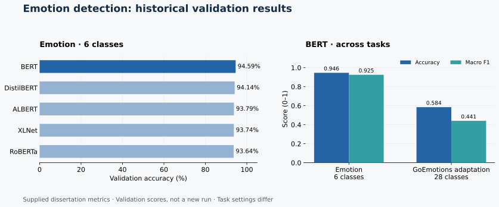

# Emotion Detection Benchmark

**Five transformer architectures. Two emotion taxonomies. An analysis of where classification breaks down.**

MSc dissertation project by **Vikas Reddy Konreddy**, University of Hertfordshire.

This project compares BERT, RoBERTa, DistilBERT, ALBERT and XLNet on the six-class
Emotion dataset, then evaluates BERT on a 28-class single-label adaptation of
GoEmotions. The work includes data exploration, preprocessing, model training,
confusion matrices and analysis of recurring misclassifications.

**Python · PyTorch · Hugging Face Transformers · scikit-learn · pandas · Matplotlib**



## Main findings

The supplied experiment results show that BERT achieved **94.59% validation
accuracy** and **0.9252 macro F1** on Emotion. On the adapted GoEmotions task,
BERT achieved **58.45% validation accuracy** and **0.4407 macro F1**.

| Model | Emotion accuracy | Macro F1 | Weighted F1 |
|:--|--:|--:|--:|
| BERT | 94.59% | 0.9252 | 0.9460 |
| DistilBERT | 94.14% | 0.9170 | 0.9409 |
| ALBERT | 93.79% | 0.9100 | 0.9377 |
| XLNet | 93.74% | 0.9137 | 0.9377 |
| RoBERTa | 93.64% | 0.9090 | 0.9364 |

Recorded BERT errors include **love → joy** (20 examples), **joy → love**
(12 examples), and **sadness → fear** (10 examples). Several rare GoEmotions
classes have zero recall in the recorded classification report.

These are **historical validation results from the supplied dissertation
artifacts**. They are not a new training run or held-out test results. The two
tasks differ in dataset, label treatment and training duration, so their gap
does not isolate the effect of label granularity. Read the
[experiment notes](docs/experiment_notes.md) for the exact scope and limitations.

## Explore the project

| File | Purpose |
|:--|:--|
| [Notebook](notebooks/emotion_detection.ipynb) | Reconstructed 45-step workflow, ready for a new run after setup |
| [Python pipeline](src/dissertation_pipeline.py) | The same workflow as a Python script |
| [Model comparison](results/model_comparison_emotion.csv) | Supplied six-class validation metrics |
| [Basic vs fine-grained](results/basic_vs_finegrained.csv) | Supplied BERT task comparison |
| [Dataset instructions](data/README.md) | Six required CSV filenames and column formats |
| [Experiment notes](docs/experiment_notes.md) | Method, provenance and reproducibility limits |
| [Original export](archive/dissertation_notebook_export.txt) | Original supplied text with historical outputs |

## Run locally

Use Python 3.10 or newer and start in the repository root:

```bash
python -m venv .venv
source .venv/bin/activate
python -m pip install -r requirements.txt
python -m jupyter lab notebooks/emotion_detection.ipynb
```

On Windows, activate with `.venv\Scripts\activate`.

Before running the notebook, manually upload the six dataset CSVs into
[`data/`](data/README.md) using the names specified there. A CUDA GPU is
recommended for training. The first run downloads pretrained model weights.
Dependency ranges are provided for setup; an exact historical environment lock
was not supplied.

Alternatively, run the full workflow from the repository root:

```bash
python src/dissertation_pipeline.py
```

New plots, checkpoints and CSVs go into `outputs/`. Historical results remain
in `results/`. No trained checkpoints are bundled with this repository.

## Research questions

1. Which recurring misclassification patterns appear across transformer architectures?
2. How does BERT perform on basic Emotion labels versus the adapted GoEmotions taxonomy?

The implementation uses max-length 128 tokenization, batch size 8 with gradient
accumulation 2, learning rate `2e-5`, seed 42 and checkpoint selection by
validation accuracy. The five Emotion models train for three epochs; the
GoEmotions BERT model trains for two.

## Dataset attribution

Emotion dataset: Saravia et al., *CARER: Contextualized Affect Representations
for Emotion Recognition* (2018). GoEmotions: Demszky et al., *GoEmotions: A
Dataset of Fine-Grained Emotions* (2020). Dataset files are supplied separately;
their original terms and attribution requirements continue to apply.

## Status

Notebook structure, all 45 reconstructed code steps, combined script syntax and
the supplied metric CSVs have been checked. Model downloads, GPU training and
new predictions have not been run as part of repository preparation.
